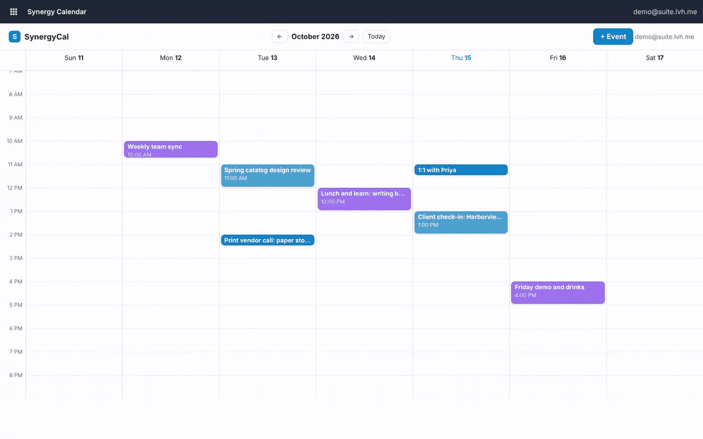
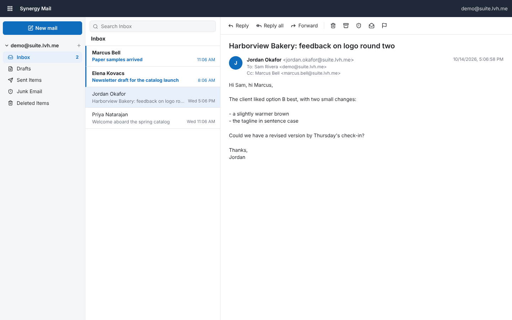
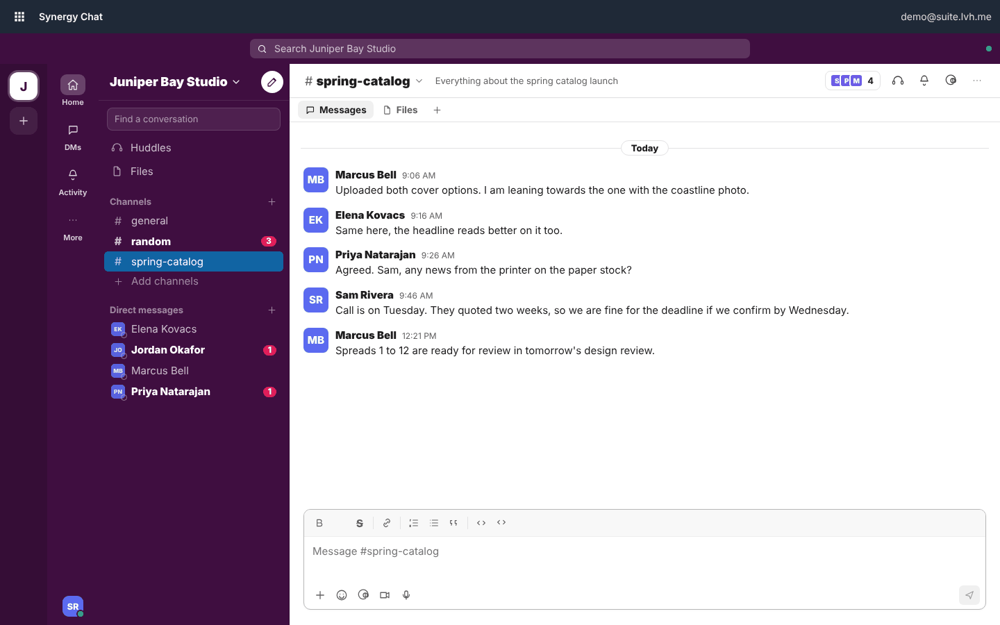
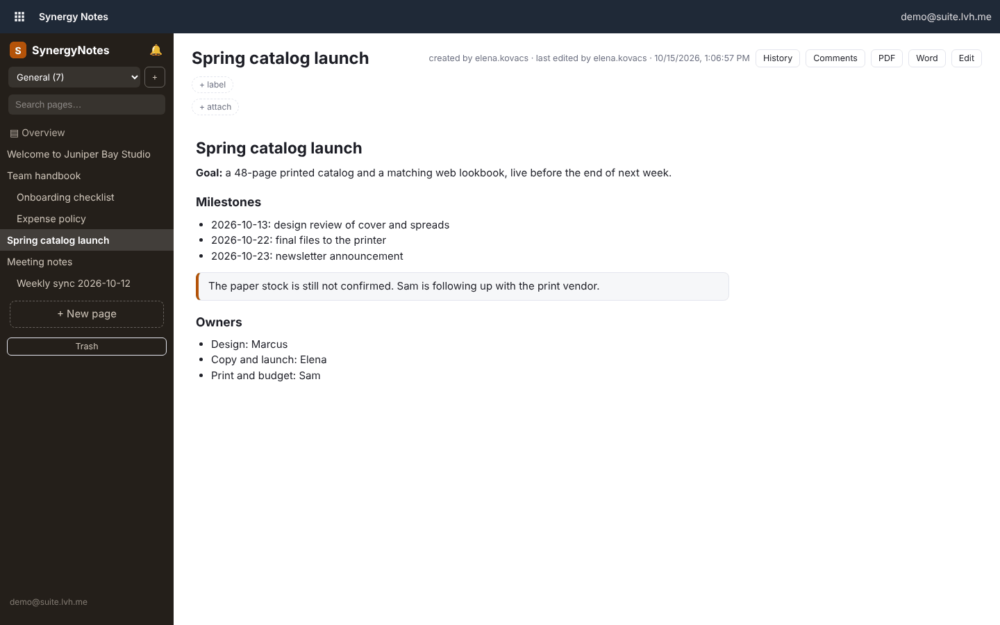
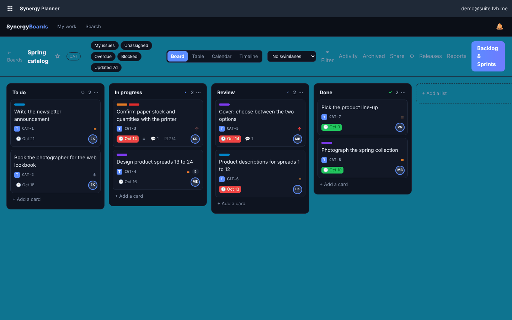
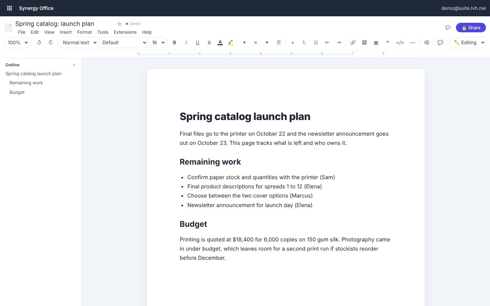

# Synergy Suite



Synergy Suite is an open source, self-hosted productivity suite modeled on Microsoft 365: mail, calendar, chat, meetings, documents, spreadsheets, slides, forms, planner, sites and notes, all behind one sign-in that you run yourself. It is licensed under the AGPL-3.0, uses Postgres for storage, and starts on one machine with Docker and one command. The apps were built separately and are being moved onto shared packages so they work as one suite, so maturity varies from app to app; the table below says where each one stands.

## Status

Maturity: **usable** means the main workflows work day to day; **early** means the basics work and obvious features are missing; **prototype** means a demo or reference that is not ready to rely on; **standalone** means it works on its own but is not yet on the suite sign-in or in the Docker deploy.

| App | Microsoft 365 equivalent | In the Docker deploy | Maturity | What works today |
|---|---|---|---|---|
| Account (`apps/auth`) | Entra ID | yes | usable | OIDC and SAML identity provider, MFA (TOTP, passkeys), admin console, SCIM; signs in every app |
| Admin (`apps/admin`) | Microsoft 365 admin center, Purview eDiscovery | yes | early | People and sign-in blocking over SCIM, app health, matters, legal holds, retention rules, keyword search and zip export across Mail, Drive, Chat, Calendar, Notes, Forms, Contacts, To Do, Bookings, CRM and Desk, audit log |
| Search (`apps/search`) | Microsoft Search, Microsoft 365 Copilot chat | yes | early | One search box (also in every app's header) across Mail, Drive, Chat, Calendar, Notes, Forms, Contacts, To Do, Bookings, CRM, Desk, Office, Planner, Sites, Base and Insights, showing only what the signed-in person can open, with filters by app; an Ask tab that answers questions from those results with numbered citations, on your own AI model |
| Mail (`apps/mail`) | Outlook | yes | usable | Folders, search, reading pane, rich-text compose, reply and forward, recipient suggestions from Contacts, outside IMAP accounts; Stalwart mail server included |
| Contacts (`apps/contacts`) | Outlook People | yes | early | Address book (emails, phones, addresses, birthdays, photos, notes), favorites, groups, A to Z index, search, vCard and Google/Outlook CSV import and export, organization directory with self-edited profiles |
| CRM (`apps/crm`) | Dynamics 365 Sales | yes | early | Accounts, contacts, leads with conversion, opportunity pipeline board with weighted forecast, activities and My Day, owner-based roles, AI lead scoring on your own model, web-to-lead, CSV export |
| Desk (`apps/desk`) | Dynamics 365 Customer Service | yes | early | Ticket queues, email intake and threaded replies over IMAP/SMTP, internal notes, canned replies, public knowledge base, intake API, ticket feed for Portal |
| To Do (`apps/todo`) | Microsoft To Do | yes | early | My Day with suggestions, Important, Planned, lists, steps, notes, due dates, reminders with browser notifications, repeating tasks, shared lists with assignments |
| Engage (`apps/engage`) | Viva Engage, Viva Connections | yes | early | Company home page with news, quick links, company sites and apps; feed with discussions, questions with best answers, praise badges, polls and articles; public and private communities with admins, pinned posts and announcements; storylines, follows, mentions, #topics, reactions and threaded replies; share to Chat; AI summaries and catch-up on your own model |
| Calendar (`apps/calendar`) | Outlook Calendar | yes | early | Week view, personal and company calendars, attendees, free/busy API; no recurring events or month view yet |
| Bookings (`apps/bookings`) | Microsoft Bookings | yes | early | Public booking pages with services, staff and opening hours, free times from each person's suite calendar, buffers, notice and booking windows, custom questions, a Meet link per online appointment, confirmation, change and cancellation emails with calendar invites, reminders, customer links to reschedule or cancel, staff booking on a customer's behalf, customer list, embedding in Sites |
| Chat (`apps/chat`) | Teams chat | yes | usable | Channels, direct messages, threads, reactions, mentions, unread counts, search, real-time updates |
| Meet (`apps/meet`) | Teams meetings | yes | early | Video rooms on LiveKit, scheduling, guest links; the media server is deployed separately and is not part of the local quickstart |
| Office (`apps/office`) | Word, Excel, PowerPoint | yes | usable | Documents, spreadsheets and slides with live co-editing, comments and sharing; opens and saves .docx, .xlsx and .pptx (with round-trip fidelity scripts over public test files); formulas, pivots, charts and conditional formatting in sheets; themes, transitions, animations and presenter view in slides |
| Drive (`apps/drive`) | OneDrive | yes | usable | Folders, drag-and-drop and folder uploads, previews (images, PDF, video, audio, text), version history, sharing with people, view links, shared libraries, recycle bin, search inside text files, zip downloads, storage quotas, AI summaries |
| Forms (`apps/forms`) | Forms | yes | early | Form builder, public form links, responses, CSV export |
| Planner (`apps/planner`) | Planner | yes | usable | Boards, lists, cards, checklists, comments, labels; board, table, calendar and timeline views; Trello and Jira import |
| Photo (`apps/photo`) | Designer / Photos | yes | early | The PhotoCraft image editor (layers, masks, PSD files) with a per-user image library |
| Base (`apps/base`) | Access, Lists | yes | usable | Databases of real Postgres tables: Access data types, datasheet editing, design view, sort, filter, search, lookups (single and multi-value) with enforced relationships, subdatasheets, a relationships diagram, a query designer with totals and criteria, SQL view with AI help (bring your own model), CSV import and export, Access (.accdb/.mdb) import of tables, records and relationships, forms with subforms that can be published as Synergy Forms online forms, reports with groups and totals that print or save as PDF, Lists-style gallery, board and calendar views, comments on records, data links that Sheets refreshes from, and sharing with owners, editors and viewers |
| Insights (`apps/insights`) | Power BI | yes | early | Dashboards and reports over Books, CRM, Desk, Base, Planner, Forms and Trust as read-only sources (no password, token or key columns), built in the Metabase report designer with your suite sign-in; dashboards shown inside Insights to the people who can open them; analysts and viewers |
| Sites (`apps/sites`) | SharePoint | yes | early | Page builder for team sites, published as public pages |
| Books (`apps/books`) | Dynamics 365 Business Central | yes | early | Double-entry ledger, invoices, estimates, bills, bank reconciliation, payroll, inventory, sales tax, financial reports, customer payments through Stripe or Square; new to the suite sign-in and Docker deploy |
| CAD (`apps/cad`) | AutoCAD-style drafting, 3D modeling | yes | early | 2D drafting with DWG and DXF (CADCraft), 3D modeling with STEP, IGES and STL (Chili3D), drawings made from 3D models, review links, version history, folders; CADCraft is pre-alpha upstream and drops entities it doesn't model yet when saving |
| Notes (`apps/notes`) | OneNote | yes | usable | Wiki spaces, page tree, live co-editing, version history, comments, attachments, PDF and Word export |
| Trust (`apps/trust`) | Purview Compliance Manager | yes | early | SOC 2, ISO 27001, HIPAA and GDPR readiness: control library mapped across frameworks, automated evidence collectors and a collector agent, append-only evidence and audit log, opt-in public trust centre |
| Home, Groups (`prototype/workspace`) | Microsoft 365 home, Groups | no | prototype | Zero-dependency Node prototype kept as a reference; its Admin, Purview, People and To Do parts now live in `apps/admin`, `apps/contacts` and `apps/todo` |
| People add-on (`addons/people`) | (HR records) | yes | early | Employee records and PTO requests with approval |
| Portal add-on (`addons/portal`) | (customer portal) | yes | early | Client records with private share links |
| Sign add-on (`addons/sign`) | (DocuSign-style) | no | standalone | E-signature with multi-party signing and templates; has its own sign-in |
| Campaigns add-on (`addons/campaigns`) | (Mailchimp-style) | no | prototype | Audiences, email builder, campaigns; sending relies on a separate mailer that is not in this repository |
| Desktop and mobile app (`clients/app`) | Microsoft 365 desktop and mobile apps | installers from CI | early | Windows, macOS, Linux, Android and iOS app that opens your suite's apps in a native window: launcher, outside links in the browser; on desktop an app menu with shortcuts and downloads to the Downloads folder. Android debug APK from CI; no store builds yet |
| Android UI (`mobile/synergy-ui`) | | no | prototype | Kotlin UI component library; no app yet |

## Screenshots

From a local instance in demo mode, signed in as the demo user.

| | |
|---|---|
|  Mail |  Calendar |
|  Chat |  Notes |
|  Planner |  Office |

Every app shares the same header, whose app launcher links to the rest of the suite:


## Try it

With Docker running:

```
git clone https://github.com/SynergyTech0/SynergySuite.git
cd SynergySuite
deploy/quickstart.sh
```

It generates `deploy/.env` with random secrets and an admin account, builds and starts the suite, and prints where to sign in (`https://calendar.suite.lvh.me`, as `admin@suite.lvh.me`). Certificates come from a local CA, so trust `deploy/local-ca.crt` or accept the browser warning. Details and trade-offs are in [deploy/README.md](deploy/README.md#try-it-on-your-machine).

To start with sample content instead of an empty suite, run `DEMO_MODE=1 deploy/quickstart.sh` the first time. It seeds a made-up company in calendar, chat, notes, planner and mail, and the sign-in page offers a shared demo login; see [Demo mode](deploy/README.md#demo-mode).

## Repository layout

| Path | M365 equivalent | Stack today |
|---|---|---|
| `apps/auth` | Entra ID (SSO, MFA, SCIM, OIDC/SAML) | Next.js 15 |
| `apps/admin` | Microsoft 365 admin center, Purview eDiscovery | Next.js 16 + Postgres |
| `apps/search` | Microsoft Search, Microsoft 365 Copilot chat | Next.js 16, no database |
| `apps/mail` | Outlook mail | Next.js 15 + Stalwart mail server |
| `apps/calendar` | Outlook calendar | Express + React/Vite |
| `apps/bookings` | Microsoft Bookings | Next.js 16 + Postgres |
| `apps/chat` | Teams chat | Express + ws + React/Vite |
| `apps/meet` | Teams meetings | Next.js 15 + LiveKit |
| `apps/office` | Word, Excel, PowerPoint | Next.js 15 + Tiptap/Hocuspocus + Univer |
| `apps/drive` | OneDrive | Next.js 16 + Postgres, file contents on disk |
| `apps/contacts` | Outlook People | Next.js 16 + Postgres |
| `apps/todo` | Microsoft To Do | Next.js 16 + Postgres |
| `apps/engage` | Viva Engage, Viva Connections | Next.js 16 + Postgres |
| `apps/crm` | Dynamics 365 Sales | Next.js 16 + Postgres |
| `apps/desk` | Dynamics 365 Customer Service | Next.js 16 + Postgres |
| `apps/forms` | Forms | Express + React/Vite |
| `apps/planner` | Planner | Next.js 16 + Drizzle |
| `apps/photo` | Photo (image editing) | Next.js 16 + PhotoCraft (Rust, WebAssembly) |
| `apps/cad` | CAD (2D drafting with DWG/DXF, 3D modeling, drawings from models, review links, version history, folders) | Next.js 16 + CADCraft (Rust, WebAssembly) + Chili3D (Open CASCADE, WebAssembly) |
| `apps/base` | Access, Lists | Next.js 16 + Postgres (one schema per database) |
| `apps/insights` | Power BI | Next.js 16 + Metabase (open source edition, AGPL) |
| `apps/sites` | SharePoint | Express + React/Vite |
| `apps/books` | Dynamics 365 Business Central (accounting) | NestJS + Prisma + React/Vite |
| `apps/notes` | OneNote | Express + React/Vite |
| `apps/trust` | Purview Compliance Manager | Next.js 16 + postgres.js (raw SQL migrations, row-level security) |
| `prototype/workspace` | 365 home, Groups | zero-dependency Node prototype, kept as a reference; Admin, Purview, People and To Do were ported into `apps/` |
| `addons/sign` | (DocuSign-style) | Next.js 14 + Prisma |
| `addons/campaigns` | (Mailchimp-style) | Next.js 15 |
| `addons/portal` | customer portal | Express + React/Vite |
| `addons/people` | HR records and PTO | Express + React/Vite |
| `clients/app` | Microsoft 365 desktop and mobile apps | Tauri 2 (Rust) + TypeScript launcher page |
| `mobile/synergy-ui` | Android UI library | Kotlin |

## Shared packages

| Package | What it gives every app |
|---|---|
| `@synergy/identity` | Who is signed in (SynergyAuth via the gateway's headers), dev-user overrides, signed guest links |
| `@synergy/compliance` | The eDiscovery protocol between the Admin center and each app: search and export routes, the shared keyword language, legal-hold and retention checks that fail closed |
| `@synergy/search` | Suite-wide search for the signed-in person: the `POST /api/search` protocol each content app answers for the Search app, with query, snippet and text helpers |
| `@synergy/db` | Postgres pool, query helper, boot-time migrations under an advisory lock |
| `@synergy/server` | Express basics: sign-in and bearer-token middleware, JSON errors, health check, SPA serving |
| `@synergy/config` | The suite's app registry (`packages/config/apps.json`): names, M365 equivalents, unique ports, URLs |
| `@synergy/shell` | `<synergy-app-bar>`, the shared header with the app launcher and the suite search box |
| `@synergy/ai` | Bring your own AI model: one setting for the whole suite, any OpenAI-compatible server (OpenAI, Ollama, vLLM, LM Studio, OpenRouter, Azure, Groq) or Anthropic |

Calendar, chat, drive, forms, mail, meet, notes, office, photo, planner and sites use them today, as do the people and portal add-ons; sign uses `@synergy/ai`. The campaigns add-on follows. Auth is the identity provider the others sign in through, so it stays standalone.

## Running locally

```
npm install
npm run build:packages
npm run ports                      # each app's default port
DATABASE_URL=postgres://... DEV_USER_EMAIL=you@example.com node apps/calendar/server/index.js
```

`DEV_USER_EMAIL` signs every request in as that user when there is no gateway. It is ignored when `NODE_ENV=production`.

## AI: bring your own model

The suite doesn't depend on any AI vendor. AI features stay off until you choose a model, and every app uses the same settings: `AI_PROVIDER`, `AI_BASE_URL`, `AI_API_KEY`, `AI_MODEL` and `AI_EMBEDDING_MODEL` (see `deploy/.env.example`). Run a local model with Ollama or vLLM to keep documents on your own hardware, or use a hosted API. An app can use a different model from the rest with prefixed settings such as `SIGN_AI_MODEL`.

Today that covers sign's field placement, Drive's file summaries, and Meet's meeting notes. New AI features go through `@synergy/ai` so they get the same choice.

## Self-hosting

See `deploy/README.md` for the one-command Docker setup on a server.

## Contributing

See [CONTRIBUTING.md](CONTRIBUTING.md). Please report security problems privately as [SECURITY.md](SECURITY.md) describes.

## License

Synergy Suite is licensed under the [GNU Affero General Public License v3.0](LICENSE). If you run a modified version as a network service, you must offer its source to your users.
